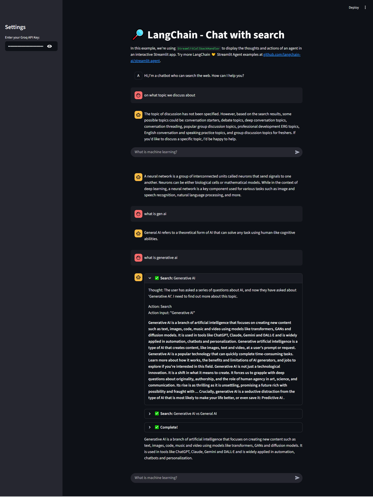

# LangChain Tool-Calling Search Chatbot (Streamlit + Groq)

A **tool-enabled conversational AI application** built using **LangChain Agents**, **Groq LLaMA 3.1**, and **Streamlit**.  
The chatbot dynamically decides **which external tools to call** (Web Search, Arxiv, Wikipedia) based on the user query using a **Zero-Shot ReAct Agent**.

---

## 🚀 Features

- 🔎 **Web Search Integration** using DuckDuckGo
- 📚 **Academic Research Support** via Arxiv API
- 🌐 **Knowledge Retrieval** using Wikipedia API
- 🤖 **LLM-powered Conversational Agent** (Groq + LLaMA 3.1)
- 💬 **Persistent Chat History** with Streamlit session state
- 🧠 **Zero-Shot ReAct Agent** for reasoning and tool usage
- 📊 **Real-time Thought Streaming** using StreamlitCallbackHandler
- 🔐 **Secure API Key Input** from Streamlit sidebar

---

## 🛠️ Tech Stack 

- **Python**
- **Streamlit**
- **LangChain**
- **Groq API**
- **LLaMA 3.1 (8B Instant)**
- **Retrieval-Augmented Generation (RAG)**
- **AI Agents**
- **Zero-Shot ReAct**
- **DuckDuckGo Search API**
- **Wikipedia API**
- **Arxiv API**
- **LLM Tool Calling**
- **Conversational AI**
- **Search-Augmented Chatbot**

---

## Agent Execution Flow
<pre>
User Question
      ↓
LLM Reasoning
      ↓
Tool Selection (Search / Arxiv / Wikipedia)
      ↓
Tool Execution
      ↓
Observation
      ↓
Final Answer
</pre>

---

## 📸 Application Screenshots (Streamlit UI)

